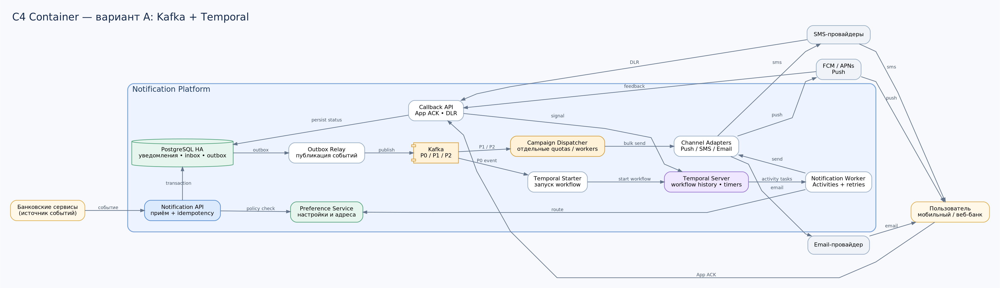
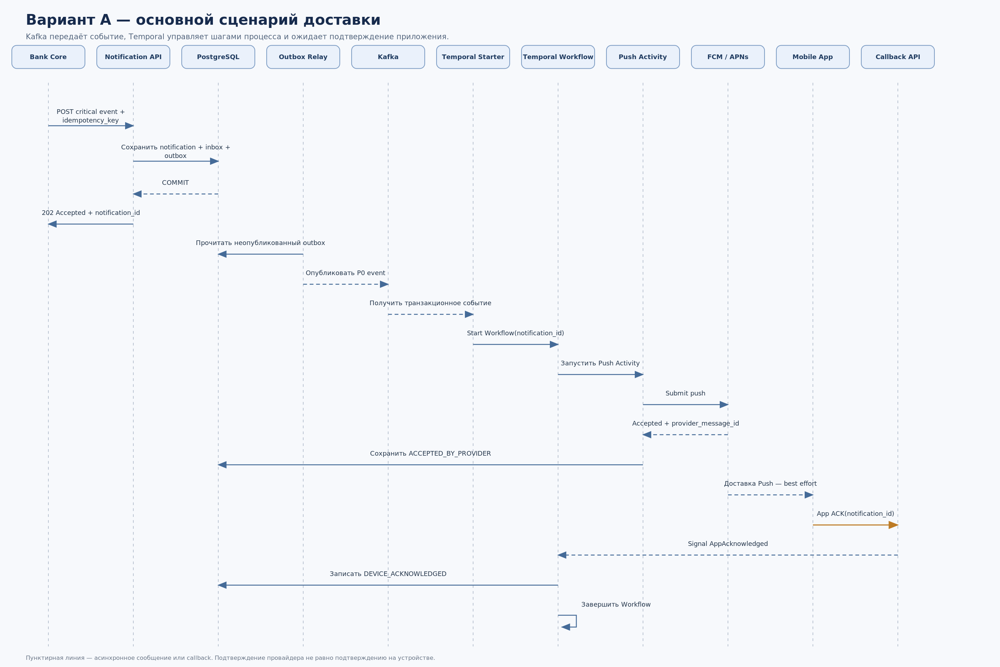
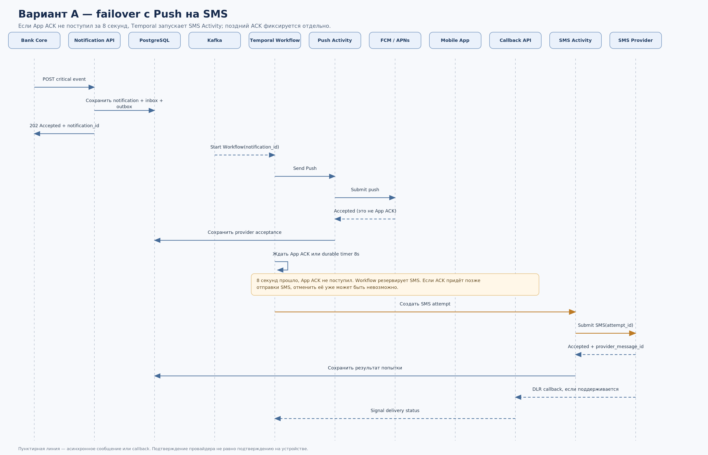
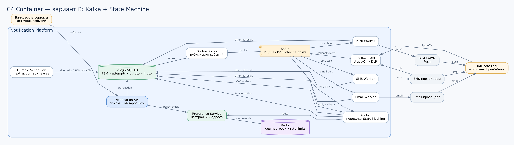
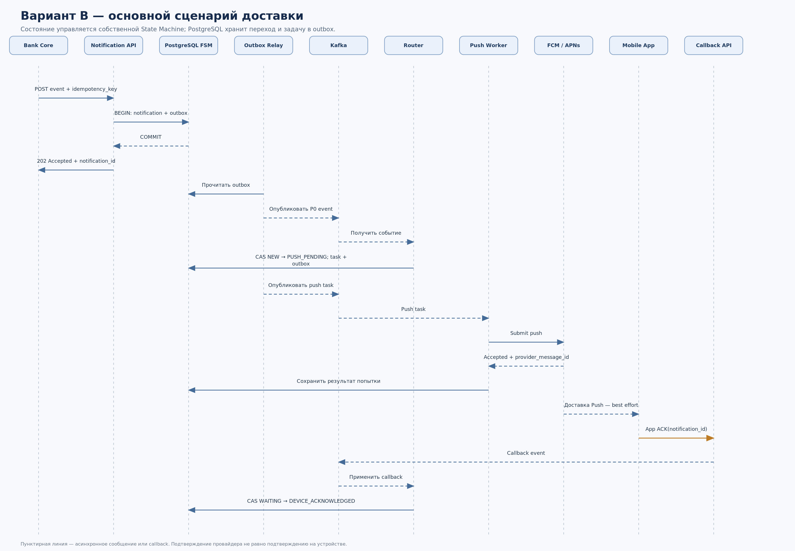
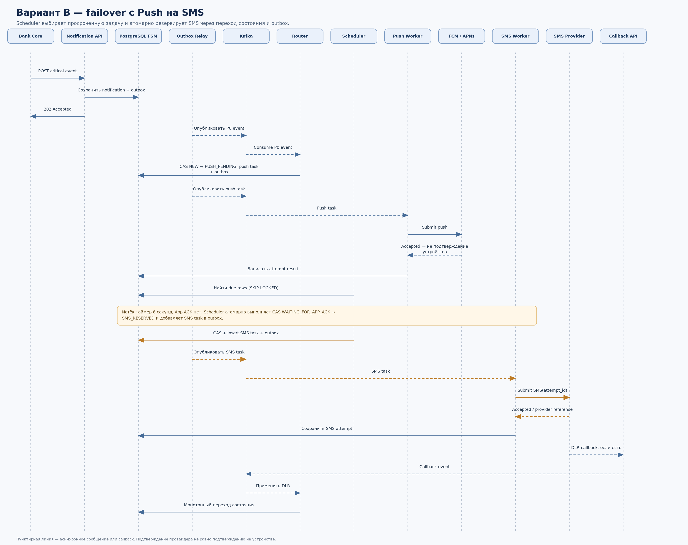

# Домашнее задание №4. Notification Platform

Диаграммы в этом документе встроены как готовые изображения: GitHub показывает их прямо на странице README. Исходники PlantUML (`.puml`) также оставлены в папке `diagrams/`, если потребуется изменить схему.

## 1. Контекст и бизнес-цели

В онлайн-банке уведомления сейчас отправляются разными командами и сервисами. Из-за этого часть сообщений задерживается, иногда приходят дубли, а общего места, где можно посмотреть состояние отправки, нет.

Предлагается сделать единую платформу уведомлений. Банковские сервисы передают ей события, а платформа выбирает канал, учитывает настройки пользователя, отправляет сообщение и сохраняет результат.

В системе будут три группы уведомлений:

| Тип | Примеры | Приоритет | Можно отключить |
|---|---|---:|---|
| Транзакционные | перевод, списание, важное действие по счёту | P0 | Нет. Пользователь может выбрать предпочтительный канал, но не отключить сам тип уведомлений |
| Сервисные | статус заявки, напоминание, информация об обслуживании | P1 | Да, если сообщение не относится к обязательным по правилам банка |
| Маркетинговые | акции, предложения, кэшбэк | P2 | Да |

Каналы доставки: Push, SMS и Email. Для критичных сообщений также будет использоваться защищённая лента уведомлений внутри мобильного и веб-банка. Она не заменяет Push или SMS, но позволяет открыть сообщение позже.

Бизнес-цели из условия:

- увеличить retention на 15%;
- снизить количество жалоб на уведомления на 30%;
- обеспечить надёжную доставку критичных сообщений.

Для первых двух целей нужно заранее определить базовый период и способ измерения. Само появление платформы ещё не доказывает, что retention вырос именно из-за неё. Для такой оценки понадобится A/B-тест или сравнение с контрольной группой.

### Что в этой работе означает «гарантированная доставка»

Платформа может гарантировать, что принятое критичное событие не потеряется внутри неё и что система будет выполнять повторы и переключение каналов по заданным правилам. Это работает при условии, что сама платформа доступна и хотя бы один внешний канал в итоге может принять сообщение.

Нельзя гарантировать, что человек обязательно прочитает уведомление. Телефон может быть выключен, у пользователя может не быть сети, а оператор или push-сервис может задержать сообщение. Поэтому статусы нужно различать:

- `ACCEPTED_BY_PLATFORM` — событие сохранено платформой;
- `ACCEPTED_BY_PROVIDER` — внешний провайдер принял запрос;
- `DEVICE_ACKNOWLEDGED` — приложение на устройстве прислало подтверждение;
- `SMS_DELIVERED` — провайдер или оператор сообщил о доставке SMS, если такой отчёт доступен;
- `USER_READ` — пользователь открыл сообщение.

Эти статусы не равны друг другу. Например, успешный ответ FCM говорит о том, что запрос принят к обработке, но не доказывает, что устройство получило Push. Поэтому HTTP 200 нельзя автоматически считать подтверждением доставки пользователю.

## 2. Функциональные требования

| ID | Требование | Как проверить |
|---|---|---|
| FR-1 | Платформа принимает уведомления от внутренних сервисов банка и сообщает, что событие принято. | Для события создаётся один `notification_id`; повтор того же запроса не создаёт новое уведомление. |
| FR-2 | Платформа отправляет сообщения через Push, SMS и Email. | В истории видно, какой канал использовался и чем закончилась каждая попытка. |
| FR-3 | Пользователь может отключать сервисные и маркетинговые уведомления и выбирать предпочтительный канал для критичных сообщений. | Новые настройки применяются к ещё не отправленным сообщениям. Критичные уведомления нельзя отключить целиком. |
| FR-4 | При сбое основного канала платформа пробует резервный канал по установленным правилам. | В истории видны причина переключения, время и выбранный резервный канал. |
| FR-5 | Повторная передача одного банковского события не должна создавать несколько логических уведомлений. | Повтор с тем же ключом идемпотентности возвращает существующее уведомление. |
| FR-6 | Пользователь может посмотреть историю критичных уведомлений в приложении или веб-банке. | Принятое критичное уведомление появляется во внутренней ленте, даже если Push или SMS не доставлены. |
| FR-7 | Сотрудник поддержки может увидеть статус уведомления и историю попыток. | По `notification_id` можно найти все попытки и причины ошибок; содержимое и персональные данные маскируются. |
| FR-8 | Платформа ограничивает частоту сервисных и маркетинговых сообщений. | Лимиты настраиваются отдельно по типу сообщения и каналу. Они не должны блокировать критичные уведомления. |

## 3. Нефункциональные требования

Значения ниже — проектные цели. Их нужно подтвердить нагрузочными тестами и договорённостями с провайдерами.

| ID | Требование | Метрика |
|---|---|---|
| NFR-1 | Критичное уведомление должно быстро доходить до этапа отправки основному провайдеру. | p99 от сохранения события в БД до начала вызова провайдера — не более 2 секунд. Это не время получения сообщения устройством. |
| NFR-2 | Переключение на SMS не должно надолго задерживаться после тайм-аута Push. | После истечения таймера p95 до начала вызова SMS — не более 2 секунд. Начальное значение таймера ожидания App ACK — 8 секунд. |
| NFR-3 | API приёма и маршрутизации критичных уведомлений должен быть доступен. | 99,99% в месяц. Внешние провайдеры в эту метрику не входят. |
| NFR-4 | Принятое критичное событие не должно теряться при отказе одного узла или одной зоны доступности. | RPO = 0 для такого сценария. Подтверждение приёма возвращается после сохранения события. |
| NFR-5 | Платформа должна выдерживать массовую нагрузку. | Не менее 5 000 событий/с в течение 15 минут; стресс-тест — 10 000 событий/с. |
| NFR-6 | Маркетинговая кампания не должна замедлять критичные сообщения. | Кампания на 1 млн пользователей увеличивает p99 критичной доставки не более чем на 10% относительно контрольной нагрузки. |
| NFR-7 | По каждому критичному уведомлению должна быть доступна история обработки. | 100% критичных сообщений имеют `notification_id`, `trace_id` и журнал изменения статусов. |
| NFR-8 | Данные пользователей должны быть защищены. | Шифрование при передаче и хранении, разграничение доступа, отсутствие телефонов, токенов и текста банковских сообщений в обычных логах. |

Доступность 99,99% означает примерно 4,3 минуты недоступности за 30-дневный месяц. Это достаточно жёсткая цель, поэтому её нужно согласовать с командой эксплуатации.

## 4. Архитектурно значимые требования (ASR)

Выделены пять требований, которые сильнее всего влияют на устройство системы.

| ID | Приоритет | ASR | Связанные требования |
|---|---|---|---|
| ASR-1 | P0 | Критичное уведомление должно быстро попадать к провайдеру, а при проблеме основного канала должен запускаться failover. | FR-4, NFR-1, NFR-2 |
| ASR-2 | P0 | Массовые рассылки не должны мешать обработке транзакционных уведомлений. | FR-2, FR-8, NFR-5, NFR-6 |
| ASR-3 | P0 | Состояние критичного уведомления должно сохраняться при сбоях и позволять продолжить обработку после восстановления. | FR-1, FR-4, FR-6, NFR-3, NFR-4 |
| ASR-4 | P1 | Повторная обработка события не должна создавать новые логические уведомления; количество дублей при переключении каналов нужно свести к минимуму. | FR-1, FR-5, NFR-4 |
| ASR-5 | P1 | Должны быть видны состояние уведомления, ошибки провайдеров и причины failover без раскрытия пользовательских данных. | FR-7, NFR-7, NFR-8 |

Почему эти требования влияют на архитектуру:

- **ASR-1.** Нельзя ждать ответа SMS или Push внутри банковской операции. Нужны асинхронная обработка, короткие тайм-ауты и отдельная логика failover.
- **ASR-2.** Нужны отдельные очереди и пулы обработчиков для P0 и массовых рассылок. Одного поля `priority` в общей очереди недостаточно.
- **ASR-3.** Состояние нельзя хранить только в памяти сервиса или в Redis с TTL. Нужна постоянная БД и механизм восстановления незавершённых действий.
- **ASR-4.** Нужны ключи идемпотентности и уникальные ограничения в постоянном хранилище. Повтор внешнего вызова всё равно нужно обрабатывать отдельно.
- **ASR-5.** Нужны идентификаторы для связи событий, журнал попыток, метрики и безопасный доступ к истории.

## 5. Ключевые архитектурные вопросы

| Вопрос | Какие требования его порождают | Почему он важен |
|---|---|---|
| Где хранить текущее состояние уведомления и как не потерять событие между БД и брокером? | FR-1, FR-5, NFR-4; ASR-3, ASR-4 | Если запись в БД прошла, а публикация в Kafka нет, уведомление может застрять. Нужен согласованный способ публикации. |
| Когда переключаться с Push на SMS? | FR-4, NFR-1, NFR-2; ASR-1 | Ответ push-провайдера не подтверждает получение устройством. Слишком короткий таймер увеличит число лишних SMS, слишком длинный задержит резервный канал. |
| Что делать, если SMS-провайдер принял сообщение, но ответ на запрос потерялся? | FR-5, NFR-4; ASR-3, ASR-4 | Повторный запрос может отправить SMS второй раз. Нужны проверка статуса и обработка неопределённого результата. |
| Как не дать кампании на миллион адресатов занять ресурсы транзакционных сообщений? | NFR-5, NFR-6; ASR-2 | Нужны раздельные очереди, лимиты и ресурсы для разных типов уведомлений. |
| Использовать готовый workflow engine или писать управление состояниями самостоятельно? | NFR-1–NFR-4; ASR-1, ASR-3 | От этого зависят сложность разработки, поддержка таймеров, восстановление после сбоев и эксплуатационные затраты. |

## 6. Архитектурные последствия ASR

| ASR | Последствия для архитектуры |
|---|---|
| ASR-1 | Асинхронный API, отдельный поток P0, тайм-ауты, circuit breaker, быстрый переход на резервный канал. |
| ASR-2 | Kafka с отдельными топиками и consumer groups, отдельные пулы воркеров, квоты и ограничение скорости кампаний. |
| ASR-3 | PostgreSQL как основное хранилище состояния, transactional outbox, журнал событий, повторная обработка и восстановление. |
| ASR-4 | Уникальный ключ события, уникальные `notification_id` и `attempt_id`, идемпотентные обработчики, сверка статуса у провайдера. |
| ASR-5 | OpenTelemetry, структурированные логи, метрики по каналам и провайдерам, журнал состояний и маскирование данных. |

## 7. Архитектурные решения, которые не подходят

1. **Вызывать Push/SMS-провайдера синхронно внутри API перевода или списания.** Это нарушает ASR-1 и ASR-3. Если внешний сервис отвечает медленно или недоступен, задержится банковская операция. Отказ провайдера не должен влиять на проведение перевода.

2. **Использовать одну очередь и один пул обработчиков для маркетинга и транзакционных уведомлений.** Это нарушает ASR-2. Рассылка на миллион адресатов может занять очередь и задержать сообщение о списании средств.

3. **Хранить единственный признак отправки только в Redis.** Это нарушает ASR-3 и ASR-4. Ключ может исчезнуть из-за сброса кэша или истечения TTL. Redis можно применять для ускорения чтения, но не как единственное хранилище состояния.

## 8. Неопределённости и риски

| Что пока неизвестно | Чем это опасно | Как проверить |
|---|---|---|
| Как быстро мобильное приложение может отправить App ACK на iOS и Android? | Таймер может запустить SMS, хотя Push уже был показан. | Сделать прототип приложения и измерить задержки ACK на разных устройствах и версиях ОС. По результатам подобрать таймер. |
| Поддерживают ли SMS-провайдеры idempotency key, проверку статуса и delivery receipt? | После тайм-аута можно случайно отправить SMS повторно. | Проверить API нескольких провайдеров, провести контрактные тесты и уточнить условия SLA. |
| Какой реальный пик событий будет у банка? | По среднему RPS нельзя точно выбрать количество партиций и воркеров. | Получить статистику от банковских сервисов и провести тесты на 5 000 и 10 000 событий/с. |
| Какие сервисные уведомления банк обязан отправлять даже при выключенных настройках? | Неправильная классификация может привести к нарушению продуктовых или юридических требований. | Согласовать список с Product, Legal и Compliance. |

---

# 9. RFC. Гарантированная доставка критичных уведомлений

## 9.1. Задача и границы решения

RFC описывает доставку транзакционных уведомлений: приём события, выбор канала, попытки отправки, переключение на резервный канал, сохранение статусов и обработку ошибок.

В RFC не рассматривается сама банковская операция. Платформа уведомлений не принимает решение о переводе или списании — она получает уже сформированное событие от банковского сервиса.

Для критичных сообщений предлагается такой порядок: Push → SMS → Email. Push используется первым, потому что он дешевле SMS. Email остаётся последним вариантом, так как обычно хуже подходит для срочных сообщений. Уведомление также записывается во внутреннюю ленту банка.

## 9.2. Политика доставки и статусы

Для критичных уведомлений пользователь не может отключить сам класс сообщений. Он может указать предпочтительный канал и порядок каналов. Если выбранный канал недоступен, платформа использует резервный.

Для сервисных и маркетинговых сообщений настройки пользователя соблюдаются. Отключение маркетинга проверяется до постановки массовой кампании в отправку.

Основные состояния уведомления:

`ACCEPTED → ROUTING → PUSH_PENDING → PUSH_SUBMITTED → DEVICE_ACKNOWLEDGED`

Если подтверждение приложения не пришло:

`PUSH_SUBMITTED → WAITING_FOR_APP_ACK → SMS_RESERVED → SMS_SUBMITTED → SMS_DELIVERED`

Также могут возникать состояния `DELIVERY_UNCONFIRMED`, `TIMEOUT_UNKNOWN`, `FAILED_REQUIRES_REVIEW` и `EXPIRED`.

`TIMEOUT_UNKNOWN` нужен для ситуации, когда запрос провайдеру был отправлен, но ответ не пришёл. Нельзя считать, что отправки не было: провайдер мог принять сообщение, а ответ потерялся по дороге.

### Когда включается failover

| Ситуация | Действие |
|---|---|
| Push-провайдер сразу вернул постоянную ошибку, например неверный токен | Не ждать таймер, перейти к SMS. |
| Push принят, но App ACK не пришёл за 8 секунд | Зарезервировать SMS и начать отправку. 8 секунд — начальное значение, его нужно проверить на реальных устройствах. |
| App ACK пришёл до таймера | Не отправлять SMS. Зафиксировать подтверждение приложения. |
| App ACK пришёл одновременно с таймером | Решение принимает один процесс изменения состояния. Если SMS уже отправляется, отмена внешнего вызова не гарантируется. |
| SMS-провайдер вернул постоянную ошибку | Использовать резервного SMS-провайдера, затем Email, если он доступен. |
| SMS-запрос завершился тайм-аутом без ответа | Сначала проверить статус у провайдера или дождаться delivery receipt. Не отправлять ту же SMS немедленно повторно. |
| Все внешние каналы недоступны | Оставить сообщение в ленте банка, сохранить задачу на повтор и поднять критический alert. |

Таймер 8 секунд не доказывает, что Push не доставлен. Приложение может не отправить ACK, даже если операционная система показала уведомление. Поэтому при failover возможен дубль между Push и SMS. Для критичных сообщений это допустимый риск, но его нужно измерять.

### Как ограничить дубли

Для одного банковского события создаётся один `notification_id`. Повторный запрос от банковского сервиса с тем же ключом идемпотентности возвращает существующую запись.

Каждая отправка в канал имеет собственный `attempt_id`. Повтор обработки одной попытки не должен создавать новую попытку. Если провайдер поддерживает idempotency key, используется стабильный ключ.

Но полностью исключить дубли при работе с внешними SMS-провайдерами нельзя. Например, провайдер мог принять SMS, но его ответ не дошёл до нашей системы. Повторный вызов в таком случае может отправить второе сообщение. Поэтому платформа использует проверку статуса и помечает такие случаи как `TIMEOUT_UNKNOWN` или `duplicate_risk`.

Цель — доставка хотя бы один раз с минимальным количеством дублей. Обещать exactly-once для независимых внешних каналов было бы неправильно.

## 9.3. Вариант A. Kafka и Temporal для критичных уведомлений

В этом варианте состояние процесса доставки ведёт Temporal. Kafka передаёт события между сервисами, PostgreSQL хранит бизнес-данные и историю попыток.

Поток работы:

1. Банковский сервис отправляет запрос в Notification API с `source_event_id` и ключом идемпотентности.
2. API в одной транзакции записывает уведомление, запись для внутренней ленты и событие в outbox-таблицу PostgreSQL.
3. После commit API возвращает `202 Accepted` и `notification_id`.
4. Outbox Relay публикует событие в Kafka. Если relay упал после публикации, событие может быть отправлено повторно — потребитель должен обработать повтор безопасно.
5. Temporal Starter запускает Workflow с ID, построенным из `notification_id`. Для одного уведомления не должно запускаться несколько независимых workflow.
6. Workflow проверяет настройки и данные для доставки, после чего вызывает Push Adapter.
7. Если приложение прислало App ACK, workflow завершает процесс. Если ACK нет за 8 секунд, workflow запускает SMS.
8. Callback API принимает App ACK и отчёты провайдера. Повторные callback не должны менять состояние повторно.

Temporal выбран потому, что в нём есть долговременное состояние процесса, таймеры и повторное выполнение задач. При падении worker процесс может продолжиться после восстановления. При этом вызовы провайдеров всё равно должны быть идемпотентными или иметь проверку статуса: сам Temporal не отменяет риск повторного внешнего вызова.

**C4 Container — архитектура варианта A:**

[Исходник диаграммы PlantUML](diagrams/c4-option-a-temporal.puml) · [SVG](diagrams/rendered/c4-option-a-temporal.svg)

**Sequence — обычная доставка:**

[Исходник диаграммы PlantUML](diagrams/sequence-a-main.puml) · [SVG](diagrams/rendered/sequence-a-main.svg)

**Sequence — failover:**

[Исходник диаграммы PlantUML](diagrams/sequence-a-failover.puml) · [SVG](diagrams/rendered/sequence-a-failover.svg)

## 9.4. Вариант B. Kafka и собственная State Machine в PostgreSQL

Во втором варианте Temporal не используется. Состояние хранится в PostgreSQL, а отдельный Scheduler проверяет, какие действия пора выполнить.

Поток работы:

1. Notification API сохраняет уведомление и outbox так же, как в варианте A.
2. Router читает событие из Kafka и создаёт состояние `PUSH_PENDING`.
3. В БД хранится текущее состояние, история изменений и `next_action_at` — время следующего действия.
4. Scheduler выбирает записи, у которых наступило время действия. Для защиты от параллельной обработки используются блокировки строк, версия записи и `SELECT ... FOR UPDATE SKIP LOCKED`.
5. После тайм-аута Scheduler меняет состояние и в той же транзакции добавляет задачу SMS в outbox.
6. Worker отправляет SMS и записывает ответ провайдера. Callback от провайдера возвращается через Callback API и обновляет состояние.

Плюс этого варианта — меньше отдельных компонентов и полный контроль состояния в PostgreSQL. Минус — команде придётся самой реализовать и поддерживать таймеры, блокировки, повторную обработку, восстановление зависших задач и защиту от гонок.

**C4 Container — архитектура варианта B:**

[Исходник диаграммы PlantUML](diagrams/c4-option-b-state-machine.puml) · [SVG](diagrams/rendered/c4-option-b-state-machine.svg)

**Sequence — обычная доставка:**

[Исходник диаграммы PlantUML](diagrams/sequence-b-main.puml) · [SVG](diagrams/rendered/sequence-b-main.svg)

**Sequence — failover:**

[Исходник диаграммы PlantUML](diagrams/sequence-b-failover.puml) · [SVG](diagrams/rendered/sequence-b-failover.svg)

## 9.5. Сравнение вариантов и выбор

| Критерий | Вариант A: Temporal | Вариант B: своя State Machine |
|---|---|---|
| Таймеры и ожидание callback | Есть готовый механизм | Нужно разработать Scheduler |
| Восстановление после падения worker | Workflow продолжает работу по сохранённой истории | Нужно восстанавливать задачи и lease самостоятельно |
| Сложность разработки | Нужно освоить Temporal и правильно писать Activities | Нужно самостоятельно реализовать большую часть механики процесса |
| Контроль состояния | Workflow history плюс PostgreSQL с бизнес-данными | PostgreSQL содержит всё состояние процесса |
| Эксплуатация | Нужен отдельный Temporal-кластер и мониторинг | Меньше инфраструктуры, но больше собственной логики |
| Основной риск | Ошибки в идемпотентности внешних Activities и нагрузке на Temporal | Ошибки в scheduler, таймерах, блокировках и восстановлении |

**Выбор — вариант A, Kafka + Temporal для критичных уведомлений.** У критичного процесса есть ожидание подтверждения, таймер и несколько шагов failover. В Temporal эти механизмы уже предусмотрены, поэтому меньше кода придётся писать и проверять самостоятельно.

Temporal не нужно запускать для каждого маркетингового сообщения. Массовые кампании будут обрабатываться отдельным Campaign Dispatcher через Kafka и собственные пулы воркеров. Это не даст большому количеству долгих процессов маркетинга занять ресурсы критичного потока.

Перед окончательным выбором всё равно нужен PoC: необходимо проверить количество одновременных workflow, скорость запуска и стоимость эксплуатации.

## 9.6. Как выбранный вариант выполняет ASR

| ASR | Решение | Как проверить |
|---|---|---|
| ASR-1 — скорость и failover | Отдельный P0-поток Kafka, отдельные воркеры, Push первым каналом, таймер и запуск SMS при необходимости. | Нагрузочный тест: p99 до начала вызова провайдера ≤ 2 секунд; p95 запуска SMS после таймера ≤ 2 секунд. |
| ASR-2 — изоляция нагрузки | Отдельные топики, consumer groups, лимиты и пулы обработчиков для транзакций и кампаний. | Провести кампанию на 1 млн адресатов одновременно с транзакционным трафиком. Проверить, что p99 P0 ухудшился не более чем на 10%. |
| ASR-3 — надёжность | PostgreSQL, transactional outbox, Kafka с репликацией, Temporal с сохранением состояния, повторные попытки и callback. | Отключить API, worker, Kafka broker и Push-провайдера по отдельности. Проверить, что принятое критичное событие не пропало. |
| ASR-4 — защита от дублей | Уникальный ключ события, `notification_id`, `attempt_id`, idempotency key провайдера при наличии, сверка статуса после timeout. | Повторить одно событие 100 раз и проверить, что логическое уведомление только одно. Отдельно проверить timeout после принятия сообщения провайдером. |
| ASR-5 — наблюдаемость | `notification_id`, `trace_id`, `provider_message_id`, журнал переходов, метрики и алерты. | Проверить, что по каждому P0 уведомлению можно восстановить всю историю, не показывая лишние персональные данные. |

## 9.7. Технологии

| Часть системы | Технология | Для чего |
|---|---|---|
| API и адаптеры | Go, REST/gRPC | Приём запросов, callback и работа с провайдерами. |
| Брокер | Apache Kafka | Передача и буферизация событий, разделение потоков. |
| Управление процессом | Temporal | Таймеры, ожидание callback, повторы и восстановление workflow. |
| Основная БД | PostgreSQL с HA-конфигурацией | Уведомления, попытки, outbox, inbox и история статусов. |
| Кэш | Redis | Кэш настроек и rate limiting. Не используется как единственный источник истины. |
| Push | FCM для Android и APNs для iOS | Отправка push-уведомлений. |
| SMS | Основной и резервный SMS-провайдер | Отправка SMS и получение delivery receipt, если поддерживается. |
| Email | Email API или SMTP-провайдер | Третий резервный канал и обычные email-уведомления. |
| Мониторинг | OpenTelemetry, Prometheus, Grafana | Трассировки, метрики и дашборды. |

Для Kafka у критичного потока нужно включить подтверждение записи от реплик (`acks=all`), идемпотентность producer и подходящие настройки репликации. Точные значения `replication.factor` и `min.insync.replicas` выбираются под конфигурацию кластера и допустимые отказы.

## 9.8. Основные данные

В PostgreSQL нужны как минимум следующие таблицы:

**`notifications`** — логическое уведомление:

- `notification_id` — уникальный ID;
- `producer`, `source_event_id`, `idempotency_key`;
- `user_id`, тип и приоритет уведомления;
- шаблон и его версия;
- текущий статус и даты создания/изменения;
- ссылка на зашифрованное содержимое или само содержимое с ограниченным сроком хранения;
- `trace_id` и `correlation_id`.

Для `(producer, idempotency_key)` должен быть уникальный индекс.

**`delivery_attempts`** — отдельные попытки отправки:

- `attempt_id`, `notification_id`;
- канал и провайдер;
- номер попытки и статус;
- `provider_message_id` и idempotency key, если поддерживается;
- время отправки и получения ответа;
- код ошибки и признак возможного дубля.

Также нужны `notification_events` для истории смены статусов, `outbox_events` для передачи событий в Kafka, `user_preferences` для настроек и `inbox_items` для внутренней ленты банка.

## 9.9. Как обеспечивается сохранность события

1. **Приём запроса.** API проверяет права сервиса-отправителя, формат события и ключ идемпотентности. В одной транзакции PostgreSQL записывает уведомление, элемент внутренней ленты и строку outbox.
2. **Ответ отправителю.** `202 Accepted` возвращается только после commit в БД. Если API упадёт после commit, отправитель может повторить запрос с тем же ключом и получить то же уведомление.
3. **Публикация в Kafka.** Outbox Relay публикует событие. Если он упадёт после публикации, но до отметки в БД, событие может попасть в Kafka ещё раз. Потребитель должен безопасно обработать повтор.
4. **Запуск workflow.** Workflow ID строится из `notification_id`, поэтому повторная команда запуска не должна создавать новый процесс доставки.
5. **Внешний вызов.** Перед отправкой создаётся запись попытки. При повторе Activity сначала проверяется результат предыдущего вызова, если провайдер предоставляет такой API. Неясный результат отмечается как `TIMEOUT_UNKNOWN`.
6. **Callback.** Callback проверяется, связывается с уведомлением и дедуплицируется по ID события провайдера. Повторный callback не должен возвращать уведомление в старое состояние.
7. **Завершение.** Все переходы записываются в историю. Если все каналы исчерпаны, сообщение остаётся во внутренней ленте, а система создаёт alert для поддержки.

## 9.10. Расчёт нагрузки

Дано: MAU — 10 млн, DAU — 3 млн. На одного активного пользователя приходится в среднем 10 уведомлений в день: 2 транзакционных, 3 сервисных и 5 маркетинговых.

За сутки получается:

- всего: `3 млн × 10 = 30 млн` уведомлений;
- транзакционных: `3 млн × 2 = 6 млн`;
- сервисных: `3 млн × 3 = 9 млн`;
- маркетинговых: `3 млн × 5 = 15 млн`.

Средняя скорость:

| Тип | Уведомлений в сутки | Среднее количество в секунду |
|---|---:|---:|
| Все | 30 млн | около 347 |
| Транзакционные | 6 млн | около 69 |
| Сервисные | 9 млн | около 104 |
| Маркетинговые | 15 млн | около 174 |

Среднее значение не показывает пиковую нагрузку. Кампания на 1 млн пользователей за 10 минут — это примерно `1 000 000 / 600 = 1 667` сообщений/с. Если отправить её за минуту, получится примерно 16 667 сообщений/с.

Для первого расчёта предлагаются такие цели:

- 5 000 событий/с — рабочий нагрузочный тест на 15 минут;
- 10 000 событий/с — стресс-тест;
- 1 000 событий/с — резерв пропускной способности для P0. Это запас для пиков, а не среднее значение;
- маркетинговую кампанию ограничивать по скорости, исходя из квот провайдера.

Peak Concurrent Users = 300 000 влияет на количество одновременных запросов к ленте и App ACK, но само по себе не позволяет вычислить RPS уведомлений.

Для Temporal стоит отдельно проверить число параллельных workflow. При среднем транзакционном потоке около 69 сообщений/с и таймере 8 секунд будет примерно `69 × 8 = 552` ожидающих workflow одновременно. При пике 1 000 событий/с оценка составит около 8 000. Это упрощённая оценка: реальное число зависит от длительности остальных шагов и повторных попыток.

Если на одно уведомление приходится в среднем 1 KB метаданных, 30 млн записей займут около 30 GB в сутки без индексов, WAL и реплик. За месяц это примерно 900 GB. Поэтому понадобится политика хранения: горячие данные держать в PostgreSQL ограниченный срок, старую историю архивировать, а содержимое сообщений хранить минимально необходимое время.

Внутренняя пропускная способность Kafka не означает, что провайдеры смогут отправить столько же сообщений. Нужно отдельно проверить лимиты FCM/APNs и SMS-провайдеров. Если SMS-провайдер не справляется с нагрузкой, система сохраняет сообщения в очереди и показывает задержку, но не может обойти ограничения поставщика.

## 9.11. Отказы и восстановление

| Сбой | Что делает система |
|---|---|
| API упал до записи в БД | Отправитель повторяет запрос с тем же ключом идемпотентности. |
| API упал после commit, но до ответа | Повтор запроса возвращает уже созданное уведомление. |
| Outbox Relay упал после публикации в Kafka | Повторная публикация возможна; потребитель обрабатывает событие идемпотентно. |
| Kafka временно недоступна | Outbox остаётся в PostgreSQL и публикуется после восстановления. |
| Temporal Worker упал | Workflow продолжится после запуска другого worker. |
| Temporal временно недоступен | События остаются в outbox/Kafka; запуск workflow повторяется после восстановления. |
| Push-провайдер недоступен | Срабатывает circuit breaker; система переходит к SMS. |
| Push принят, но App ACK нет | Через 8 секунд запускается SMS. Возможность дубля фиксируется. |
| SMS-провайдер вернул timeout | Система проверяет статус или ждёт receipt и не делает слепой повтор. |
| Callback пришёл повторно или не по порядку | Callback дедуплицируется, состояние не переводится назад. |
| Все каналы недоступны | Уведомление остаётся в БД и ленте банка, повторяется по политике, создаётся alert. |

## 9.12. Безопасность и наблюдаемость

Доступ банковских сервисов к API должен проверяться через service identity, например mTLS или OAuth2. Для callback нужно проверять подпись или сертификат провайдера, а также защищаться от повторной отправки старых callback.

Телефоны, email, push-токены и содержимое банковских сообщений должны шифроваться при передаче и хранении. Полный текст сообщения, номер карты, секреты и токены не должны попадать в обычные логи. Для сотрудников поддержки нужен ограниченный доступ с маскированием данных и записью действий в аудит.

Для наблюдаемости используются:

- `notification_id` — общий идентификатор уведомления;
- `trace_id` — техническая трассировка обработки;
- `provider_message_id` — идентификатор сообщения у внешнего провайдера;
- журнал переходов между статусами.

Основные метрики:

- время от приёма до начала отправки;
- время ожидания App ACK;
- доля переключений Push → SMS;
- количество ошибок и тайм-аутов по каждому провайдеру;
- задержка очередей Kafka;
- возраст самой старой записи outbox;
- количество уведомлений со статусом `TIMEOUT_UNKNOWN`;
- стоимость отправки по каналам.

Нужно настроить оповещения при нарушении p99 для P0, росте ошибок провайдера, увеличении очереди, росте числа неопределённых попыток и недоступности Temporal. В метки метрик нельзя добавлять user ID, телефон или email: это создаст проблемы с приватностью и высокой кардинальностью.

## 9.13. Компромиссы и ограничения

1. **Доставка и дубли.** At-least-once уменьшает риск потери сообщения, но иногда приводит к повторной отправке. Между нашей БД и независимым SMS-провайдером нельзя обещать exactly-once без поддержки со стороны провайдера.
2. **Скорость и стоимость.** Чем раньше запускать SMS, тем быстрее пользователь узнает о событии, но тем больше будет лишних SMS. Таймер 8 секунд нужно проверить на реальной статистике.
3. **Temporal и собственная State Machine.** Temporal снижает объём кода для таймеров и восстановления, но добавляет отдельную систему, которую нужно обслуживать. Собственная FSM проще по инфраструктуре, но сложнее в разработке.
4. **App ACK и фактическое получение.** Отсутствие ACK не обязательно означает, что Push не был показан. Поэтому полностью исключить межканальные дубли нельзя.
5. **Внешние провайдеры.** Платформа может сохранить сообщение и повторять попытки, но не может гарантировать работу оператора связи или устройства пользователя.

## 9.14. План внедрения и проверки

1. Сначала проверить возможности провайдеров: статусы, delivery receipt, idempotency key, лимиты и SLA.
2. Сделать Notification API, PostgreSQL, outbox и Kafka. На этом этапе проверить повторные запросы и восстановление после сбоя.
3. Добавить Temporal Workflow, Push, App ACK и SMS-failover.
4. Добавить резервного SMS-провайдера, Email как третий канал, обработку `TIMEOUT_UNKNOWN` и внутреннюю ленту.
5. Подключать банковские сервисы постепенно, сравнивая задержки, ошибки и жалобы со старым способом отправки.
6. Провести нагрузочные и отказоустойчивые тесты до переключения всех команд.

Минимальный набор нагрузочных проверок: 347 событий/с как средний расчётный поток, 5 000 событий/с в течение 15 минут, стресс-тест 10 000 событий/с, кампания на 1 млн адресатов, одновременная нагрузка на P0 и отказ Push-провайдера. Также нужно проверить потерю callback, повтор одного события, перезапуск Temporal Worker и ограничение пропускной способности SMS.

## 9.15. Источники

- [Firebase Cloud Messaging: срок жизни сообщения](https://firebase.google.com/docs/cloud-messaging/understand-delivery) — принятие запроса провайдером и доставка на устройство являются разными событиями.
- [Apache Kafka: гарантии доставки](https://kafka.apache.org/documentation/#semantics) — границы at-most-once, at-least-once и exactly-once.
- [Temporal: Workflow и Tasks](https://docs.temporal.io/tasks) — выполнение и восстановление workflow.
- [Temporal: Retry Policies](https://docs.temporal.io/encyclopedia/retry-policies) — повторные попытки выполнения задач.

Числа 2 секунды, 8 секунд, 5 000/10 000 событий в секунду и RPO = 0 являются проектными целями для этого задания. Их нельзя считать подтверждёнными характеристиками провайдеров или готовой системы до проведения тестов.
