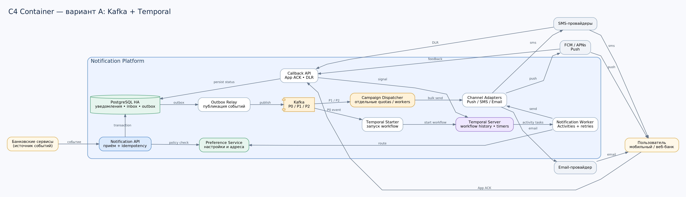
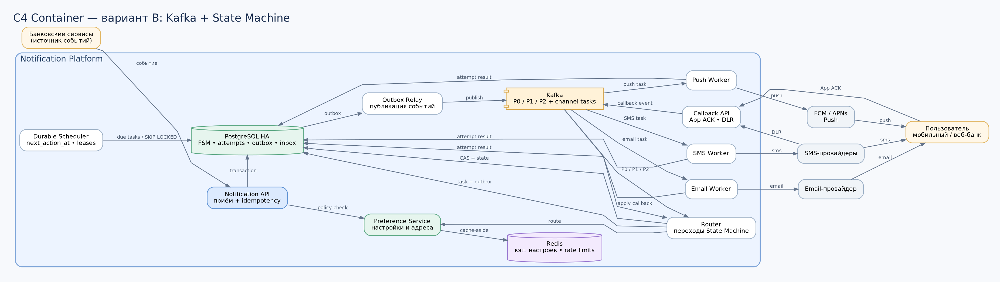
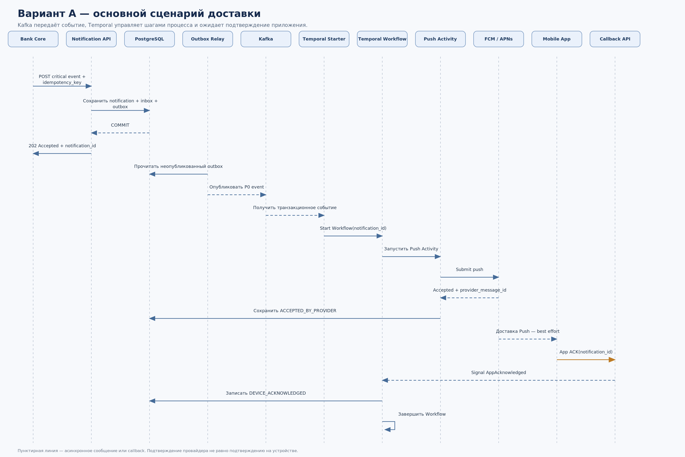
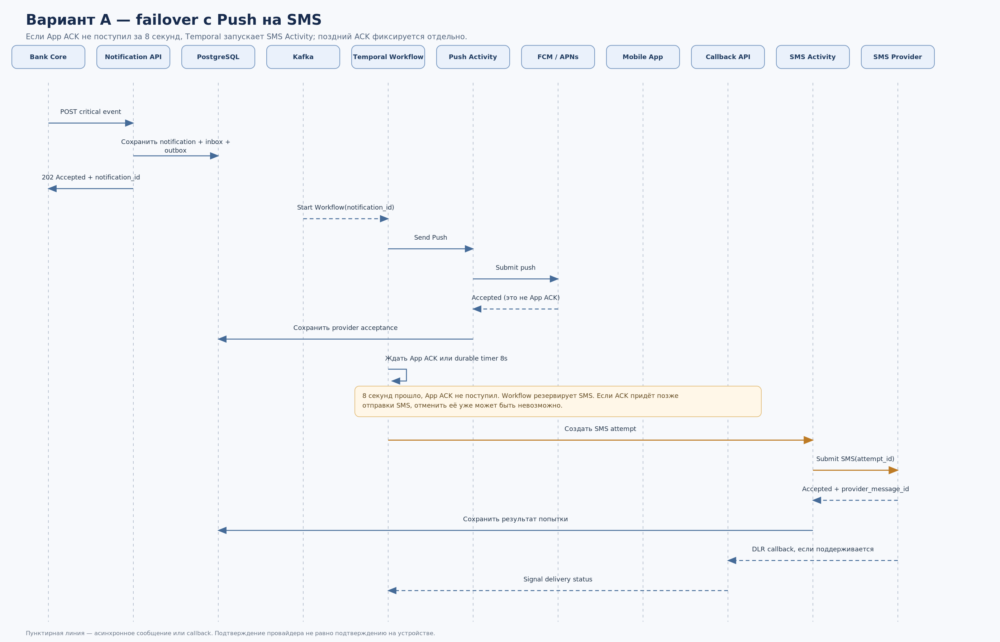
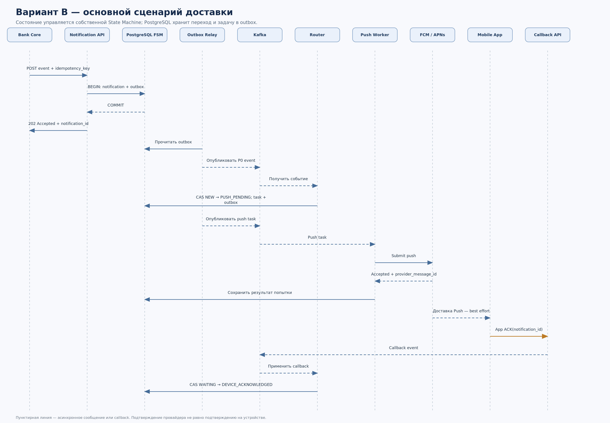
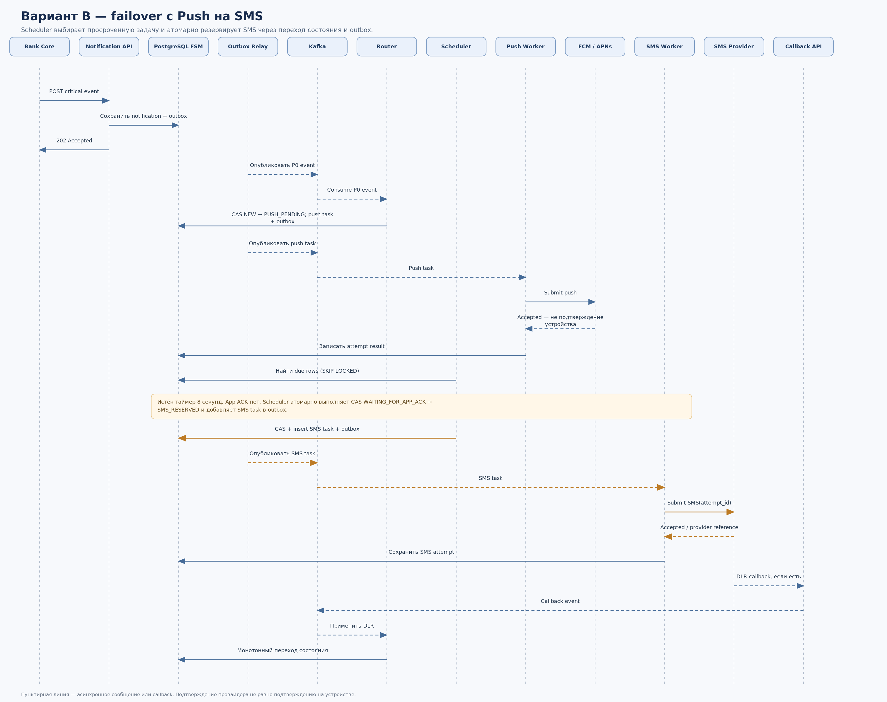

# Диаграммы проекта

## C4 Container

### Вариант A — Kafka + Temporal

[Исходник PlantUML](c4-option-a-temporal.puml) · [SVG](rendered/c4-option-a-temporal.svg)

### Вариант B — Kafka + State Machine

[Исходник PlantUML](c4-option-b-state-machine.puml) · [SVG](rendered/c4-option-b-state-machine.svg)

## Sequence diagrams

### Вариант A — основной сценарий

[Исходник PlantUML](sequence-a-main.puml) · [SVG](rendered/sequence-a-main.svg)

### Вариант A — failover

[Исходник PlantUML](sequence-a-failover.puml) · [SVG](rendered/sequence-a-failover.svg)

### Вариант B — основной сценарий

[Исходник PlantUML](sequence-b-main.puml) · [SVG](rendered/sequence-b-main.svg)

### Вариант B — failover

[Исходник PlantUML](sequence-b-failover.puml) · [SVG](rendered/sequence-b-failover.svg)
